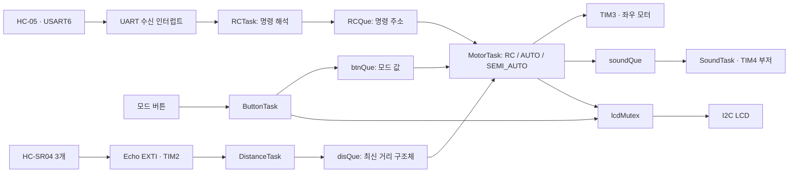
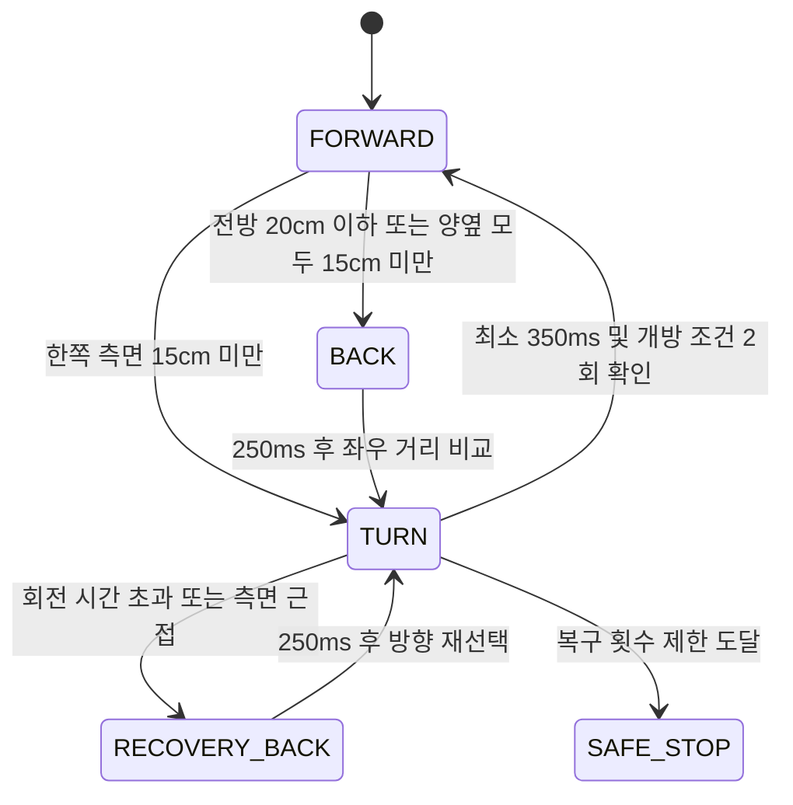

# STM32 · FreeRTOS RC카

블루투스 수동 조작과 초음파 기반 장애물 회피 주행을 결합한 STM32 RC카 팀 프로젝트입니다. FreeRTOS 태스크로 입력·거리 측정·모터 제어·사운드를 나누고, 큐와 뮤텍스를 사용해 데이터를 전달하고 LCD 접근을 조정했습니다.

**본인 담당: AUTO 자율주행 및 SEMI_AUTO 반자동 제어.** 좌·전방·우측 거리로 회피 방향을 판단하는 상태 머신, 회전 실패 시 복구, 수동 개입과 장애물 조건의 처리에 초점을 맞췄습니다.

## 동작 시연

- [AUTO 장애물 회피](https://drive.google.com/file/d/1t_CEiHCWLjFkZ1zzyVovJlfsNegVc83t/view)
- [SEMI_AUTO 반자동 주행](https://drive.google.com/file/d/1KM_rYslX-1d9qEa9f7ZQAqc1H_H4JfmB/view)
- [블루투스 수동 조작](https://drive.google.com/file/d/1Gq8mVAsGUAhyRUPcj9X02W0VArgi7ETX/view)

## 개발 환경과 구성

| 항목 | 구성 |
| --- | --- |
| MCU | STM32F411RE |
| 개발 환경 | C, STM32CubeIDE, STM32 HAL |
| RTOS | FreeRTOS, CMSIS-RTOS v1 API와 FreeRTOS 큐 API 사용 |
| 거리 센서 | HC-SR04 3개: 좌·전방·우측 |
| 무선 입력 | HC-05, USART6 9600bps |
| 구동 | DC 모터 2개, TIM3 CH1·CH3 PWM |
| 출력 | I2C LCD, LED, TIM4 CH2 부저 |

STM32F411RE 기반 보드를 사용했습니다. 주변장치 연결은 [핀맵](docs/pinmap.md)에 정리했습니다.

## 담당 역할

| 구분 | 범위 |
| --- | --- |
| **본인** | AUTO·SEMI_AUTO 제어 |
| 팀 전체 시스템 | 블루투스 수동 조작, 센서·모터·표시장치·사운드와 RTOS 통합 |

본인 구현은 아래 AUTO·SEMI_AUTO 항목에, 팀 전체의 RTOS·하드웨어 연동은 시스템 아키텍처에 정리했습니다.

## 주행 모드

| 모드 | 동작 |
| --- | --- |
| RC | 블루투스 명령에 따른 전진·후진·좌우 회전·정지 |
| AUTO | 거리 조건에 따른 직진·후진·회전·복구·정지 |
| SEMI_AUTO | 기본 자동주행 중 방향 명령으로 수동 개입, 버튼 해제 후 자동 제어 복귀 |

모드 선택 버튼은 PC0(RC), PC1(AUTO), PC2(SEMI_AUTO)입니다. 현재 블루투스 파서는 방향·정지·재개·속도 명령을 처리하며, 별도의 AUTO 모드 전환 문자열은 없습니다.

## 시스템 아키텍처



거리 데이터는 깊이 1 큐에 `xQueueOverwrite()`로 갱신하고, 모터 태스크가 `xQueuePeek()`으로 읽습니다. 과거 거리값을 순서대로 처리하기보다 최신 상태로 판단하기 위한 구성입니다. 각 센서는 순차 측정되므로 세 거리값이 같은 순간의 측정치는 아닙니다.

7개 태스크가 모두 Normal 우선순위로 생성됩니다. 실제 주요 기능은 Motor·Button·RC·Distance·Sound 태스크에 있으며, default는 LCD 초기화 후 대기하고 CommTask는 대기 루프입니다. [태스크와 데이터 전달](docs/rtos.md)

## 본인 구현: AUTO 장애물 회피

관련 코드: [motor_AUTO_control_task()](firmware/Core/Src/ap/task/motor_control_task/motor_control_task.c)

### 거리 유효성 확인

거리 데이터가 없거나 유효하지 않거나, 구조체 갱신 시점으로부터 600ms가 초과하면 모터를 정지합니다. AUTO 진입 또는 데이터 오류 이후에는 새 전방 측정이 시작된 것을 확인한 뒤 주행 판단을 재개합니다.

### 회피 상태 머신



전방 정지 기준은 20cm, 직진 복귀 기준은 30cm로 구분합니다. 최소 350ms 회전한 후 서로 다른 전방 측정에서 **전방 30cm 이상·좌우 각각 15cm 이상**을 2회 연속 확인해야 직진으로 돌아갑니다.

회전이 1300ms 이상 지속되거나 회전 방향의 측면이 지나치게 가까워지면 후진 복구를 시도합니다. 복구 시 좌우 공간 차이가 작으면 이전에 실패한 방향의 반대쪽을 선택하며, 복구 횟수 제한에 도달하면 `AUTO_SAFE_STOP`으로 전환합니다.

## 본인 구현: SEMI_AUTO 수동 개입

관련 코드: [motor_SEMI_control_task()](firmware/Core/Src/ap/task/motor_control_task/motor_control_task.c)

- 방향 명령이 없으면 AUTO 제어를 사용합니다.
- 방향 명령을 받으면 수동 제어로 전환하고, 방향 버튼 해제 명령에서 자동 제어를 다시 초기화합니다.
- `STOP`은 일시정지 상태를 유지하고 `RUN`은 자동 제어를 재개합니다.
- 수동 개입 중에도 거리 데이터가 유효하지 않거나 오래되면 정지합니다.
- 전진은 전방 20cm 이하, 좌·우 회전은 해당 방향 5cm 이하에서 제한합니다.

위험 방향 명령은 정지로 제한하며, 수동 개입 중 자동 회피 동작으로 즉시 전환하는 구조는 아닙니다. 후방 센서가 없어 수동 후진의 후방 장애물 감지는 지원하지 않습니다.

## 트러블슈팅과 설계 판단

주행은 정상적으로 동작했지만, 고정된 거리의 물체를 측정하는 중에도 간헐적으로 거리 표시가 `---`로 바뀌는 현상을 경험했습니다. 당시 연장 점퍼선의 접촉 문제를 의심했으며, 원인은 확정하지 못했습니다. 현재 코드는 측정 실패를 유효성 정보에 반영하고, AUTO·SEMI_AUTO에서 유효한 거리 데이터가 없으면 정지하도록 처리합니다.

| 주제 | 처리 |
| --- | --- |
| 오래되거나 실패한 거리값으로 주행 | 유효성·갱신 시점 확인, 정지 후 새 전방 측정 요구 |
| 잠깐 열린 전방값으로 조기 직진 | 최소 회전 시간과 서로 다른 전방 측정 2회 확인 |
| 구석에서 회전만 반복 | 시간·측면 거리 기반 후진 복구와 방향 재선택 |
| 모터·부저의 타이머 주기 간섭 | 팀 시스템에서 모터 TIM3와 부저 TIM4 분리 |
| 여러 태스크의 LCD 접근 | 명령 전달 큐와 별도로 `lcdMutex` 사용 |

거리값 미표시 현상의 분석과 제어 조건은 [설계·트러블슈팅 문서](docs/design-notes.md)에 정리했습니다.

## 실행 준비

1. STM32CubeIDE에서 `firmware/`의 기존 프로젝트 `20261116_RC_AUTO`를 가져옵니다.
2. 포함된 `.ioc` 및 [핀맵](docs/pinmap.md)을 실제 배선과 대조합니다.
3. 빌드 후 보드에 다운로드합니다.
4. 모드 버튼으로 RC·AUTO·SEMI_AUTO를 선택합니다.
5. 블루투스 명령은 `*`로 끝나도록 설정합니다. 예: `F*`, `L*`, `STOP*`, `RUN*`.

세부 명령은 [RTOS·통신 문서](docs/rtos.md)를 참고하세요.

## 저장소 구성

```text
firmware/
  Core/Src/ap/task/    모드·거리·입력·사운드 태스크
  Core/Src/driver/     주변장치 드라이버
  Core/Src/freertos.c  태스크·큐·뮤텍스 생성
  Drivers/            HAL·CMSIS
  Middlewares/        FreeRTOS
  *.ioc, *.ld         MCU 설정·링커 스크립트
docs/
  pinmap.md
  rtos.md
  design-notes.md
```

제공된 소스와 프로젝트 설정을 보존하고 `Debug/` 빌드 산출물만 제외했습니다. 원본의 작성자·저작권·라이선스 표기를 유지합니다.
