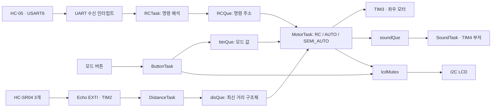
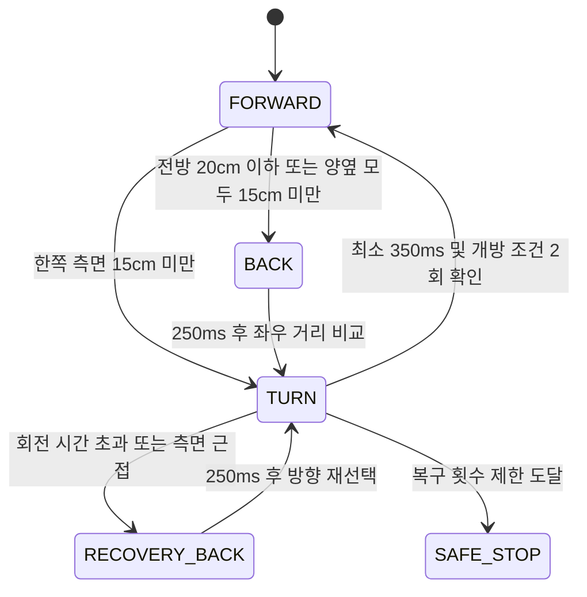

# 시스템 구조와 핵심 구현

## 전체 구조

거리 데이터는 깊이 1 큐에 `xQueueOverwrite()`로 갱신하고, 모터 태스크가 `xQueuePeek()`으로 읽습니다. 과거 거리값을 순서대로 처리하기보다 최신 상태로 판단하기 위한 구성입니다. 각 센서는 순차 측정되므로 세 거리값이 같은 순간의 측정치는 아닙니다.

7개 태스크가 모두 Normal 우선순위로 생성됩니다. 실제 주요 기능은 Motor·Button·RC·Distance·Sound 태스크에 있으며, default는 LCD 초기화 후 대기하고 CommTask는 대기 루프입니다. [태스크와 데이터 전달](rtos.md)

## 본인 구현: AUTO 장애물 회피

관련 코드: [motor_AUTO_control_task()](../firmware/Core/Src/ap/task/motor_control_task/motor_control_task.c)

### 거리 유효성 확인

거리 데이터가 없거나 유효하지 않거나, 구조체 갱신 시점으로부터 600ms가 초과하면 모터를 정지합니다. AUTO 진입 또는 데이터 오류 이후에는 새 전방 측정이 시작된 것을 확인한 뒤 주행 판단을 재개합니다.

### 회피 상태 머신

전방 정지 기준은 20cm, 직진 복귀 기준은 30cm로 구분합니다. 최소 350ms 회전한 후 서로 다른 전방 측정에서 **전방 30cm 이상·좌우 각각 15cm 이상**을 2회 연속 확인해야 직진으로 돌아갑니다.

회전이 1300ms 이상 지속되거나 회전 방향의 측면이 지나치게 가까워지면 후진 복구를 시도합니다. 복구 시 좌우 공간 차이가 작으면 이전에 실패한 방향의 반대쪽을 선택하며, 복구 횟수 제한에 도달하면 `AUTO_SAFE_STOP`으로 전환합니다.

## 본인 구현: SEMI_AUTO 수동 개입

관련 코드: [motor_SEMI_control_task()](../firmware/Core/Src/ap/task/motor_control_task/motor_control_task.c)

- 방향 명령이 없으면 AUTO 제어를 사용합니다.
- 방향 명령을 받으면 수동 제어로 전환하고, 방향 버튼 해제 명령에서 자동 제어를 다시 초기화합니다.
- `STOP`은 일시정지 상태를 유지하고 `RUN`은 자동 제어를 재개합니다.
- 수동 개입 중에도 거리 데이터가 유효하지 않거나 오래되면 정지합니다.
- 전진은 전방 20cm 이하, 좌·우 회전은 해당 방향 5cm 이하에서 제한합니다.

위험 방향 명령은 정지로 제한하며, 수동 개입 중 자동 회피 동작으로 즉시 전환하는 구조는 아닙니다. 후방 센서가 없어 수동 후진의 후방 장애물 감지는 지원하지 않습니다.
